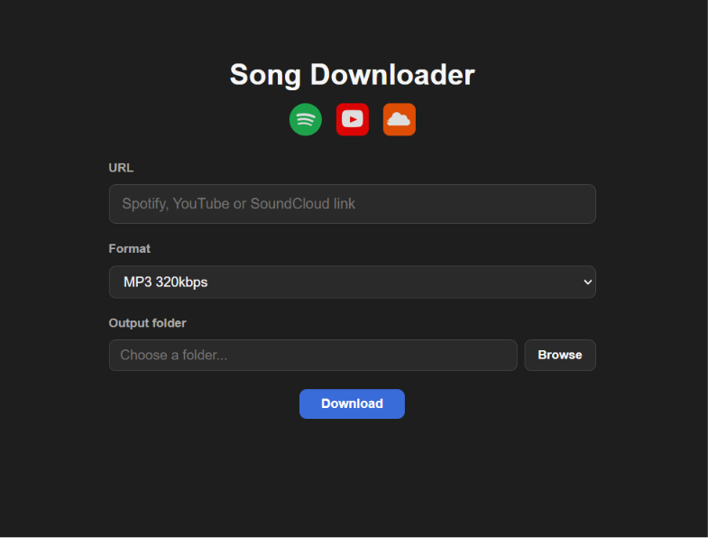

# Song Downloader

A desktop app to download songs and playlists from Spotify, YouTube, and SoundCloud as MP3 (320kbps) or AIFF.



---

## Download

Download the latest installer:

**[⬇ Download Song-Downloader.msi](https://github.com/TiesvdSar/Song-Downloader/releases/latest)**

This app is open source — the code you're running is exactly what's in this repo. Every release is built directly from a tagged commit by [this GitHub Actions workflow](.github/workflows/release.yml), so you can check the [source](.), the [workflow run for any release](https://github.com/TiesvdSar/Song-Downloader/actions/workflows/release.yml), and the [release history](https://github.com/TiesvdSar/Song-Downloader/releases) yourself rather than taking it on faith.

---

## Installation

### 1. Install the app
Run the downloaded `.msi` file and follow the installer steps.

### 2. Install the required tools

The app needs three tools installed on your computer to work. Each one is open source — links below go to the official project/source so you can check what you're installing before you install it, rather than trusting this README blindly.

#### Python
Download and install Python from [python.org](https://www.python.org/downloads/) — the official distribution, source on [GitHub](https://github.com/python/cpython).
> During installation, check **"Add Python to PATH"**.

#### yt-dlp
Open **Command Prompt** and run:
```
pip install yt-dlp
```
This installs from [PyPI](https://pypi.org/project/yt-dlp/), which is built from the official [yt-dlp GitHub repo](https://github.com/yt-dlp/yt-dlp) (140k+ stars, actively maintained fork of youtube-dl).

#### spotdl
`spotdl` depends on specific, older versions of `fastapi`/`starlette`/`uvicorn`. Installing it directly with `pip install spotdl` can silently downgrade those packages for every other Python tool on your machine (or get silently broken itself if something else later upgrades them). Install it isolated instead:
```
pip install --user pipx
pipx ensurepath
pipx install spotdl
```
If `pipx` isn't an option, a dedicated virtual environment works too:
```
python -m venv %USERPROFILE%\.spotdl-venv
%USERPROFILE%\.spotdl-venv\Scripts\pip install spotdl
```
...then add `%USERPROFILE%\.spotdl-venv\Scripts` to your `PATH`.

`spotdl` installs from [PyPI](https://pypi.org/project/spotdl/), built from the official [spotDL/spotify-downloader GitHub repo](https://github.com/spotDL/spotify-downloader). `pipx` itself is the official Python Packaging Authority tool — [source](https://github.com/pypa/pipx).

#### ffmpeg
Download and install ffmpeg using **winget**. Open **Command Prompt** and run:
```
winget install Gyan.FFmpeg
```
This installs the Windows builds maintained by Gyan Doshi ([build source/repo](https://github.com/GyanD/codexffmpeg)), packaged from the official [FFmpeg project](https://ffmpeg.org/) — the same builds recommended on [ffmpeg.org's download page](https://ffmpeg.org/download.html#build-windows).

After installing, **restart your computer** to make sure everything is recognised.

---

## How to use

### 1. Paste a link
Copy a link from Spotify, YouTube, or SoundCloud and paste it into the URL field.

Supported links:
- `https://open.spotify.com/playlist/...`
- `https://www.youtube.com/watch?v=...`
- `https://www.youtube.com/playlist?list=...`
- `https://soundcloud.com/...`

### 2. Choose a format
Select **MP3 320kbps** or **AIFF** from the format dropdown.

### 3. Set a delay (optional)
Choose a delay between songs to avoid being throttled by YouTube:

| Option | Best for |
|--------|----------|
| None | Single songs or very short playlists |
| Light — 3–6s | Most playlists (recommended) |
| Safe — 8–16s | Large playlists (100+ songs) |

Already downloaded songs are always skipped instantly regardless of the delay setting.

### 4. Choose an output folder
Click **Browse** and select the folder where you want the songs saved.

### 5. Click Download
Click the **Download** button. The log at the bottom shows live progress. When everything is done you will see:
```
✓ Download complete.
```

### Already downloaded songs
If a song is already in the output folder it will be skipped automatically — no duplicates.

### Updates
The app checks for a new version on startup. If one is available, a banner appears at the top — click **Update now** to download, install, and restart automatically.

---

## Releasing a new version

*(maintainer only)*

1. Bump the version in `Song-Downloader/src-tauri/tauri.conf.json` (`"version"`) and `Song-Downloader/package.json` (`"version"`) — they should match.
2. Commit that change.
3. Tag and push:
   ```
   git tag v0.2.0
   git push --tags
   ```
4. GitHub Actions ([`.github/workflows/release.yml`](.github/workflows/release.yml)) builds the installer, signs it, and publishes a GitHub Release with `latest.json` automatically. No manual build/upload step needed.

Existing installs pick up the new version automatically via the in-app updater (see [Updates](#updates) above).

**Signing key**: updates are verified with a keypair generated via `tauri signer generate`. The private key + password are stored as the `TAURI_SIGNING_PRIVATE_KEY` / `TAURI_SIGNING_PRIVATE_KEY_PASSWORD` GitHub Actions secrets (used only by the release workflow) and backed up locally at `%USERPROFILE%\.tauri-keys\`. **Back that folder up somewhere safe (password manager, offline storage) — if it's lost, you can't sign future updates without generating a new keypair, which would stop existing installs from trusting new releases** (their embedded public key would no longer match).

---

## Troubleshooting

**"Failed to start process"** — yt-dlp or Python is not installed correctly. Re-run the installation steps above and restart your computer.

**Download fails immediately** — ffmpeg may not be installed. Run `winget install Gyan.FFmpeg` in Command Prompt.

**Spotify downloads not working** — make sure `spotdl` is installed: `pip install spotdl`.

**Every song fails with `YT-DLP download error` or `HTTP Error 403`** — YouTube changed how it serves audio and yt-dlp is out of date. `spotdl` uses its own copy of yt-dlp, separate from the one used for YouTube and SoundCloud links, so update the right one:
- Spotify links, `spotdl` installed with `pipx`: `pipx runpip spotdl install -U yt-dlp`
- Spotify links, `spotdl` installed in a venv: `%USERPROFILE%\.spotdl-venv\Scripts\python -m pip install -U yt-dlp`
- YouTube and SoundCloud links: `pip install -U yt-dlp`

**Spotify downloads crash with a Python traceback mentioning `fastapi`/`starlette`/`on_startup`** — a different Python tool on your machine upgraded `starlette`/`anyio`/`uvicorn` past what `spotdl`'s pinned `fastapi` version supports. Reinstall `spotdl` isolated via `pipx` (see Installation above) so it can't be affected by, or affect, other Python packages.
